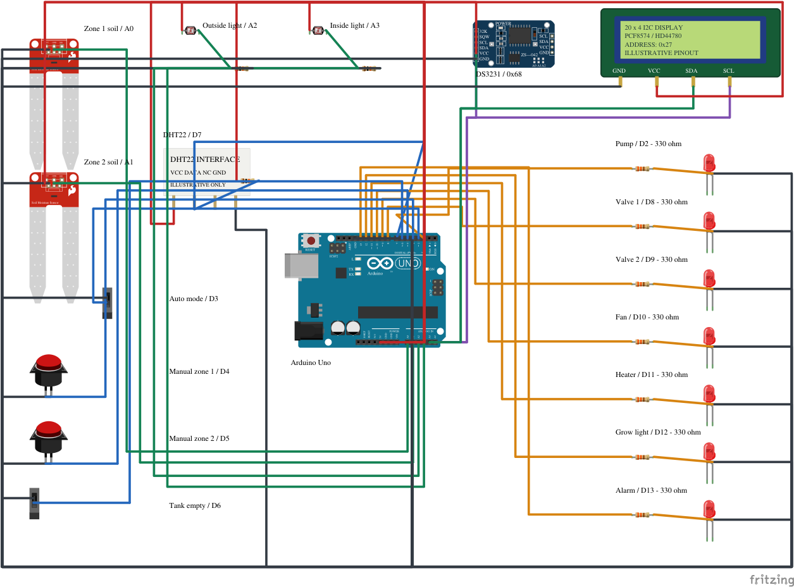

# Visuino AI Greenhouse Controller

**Work in progress — compiled candidate. Whole-program Lab runtime is not verified.**

A modular Arduino Uno teaching project: two-zone irrigation, source-empty protection, manual/automatic operation, independent temperature and grow-light control, DS3231 clock guard, combined alarm and20x4 I2C display. Bench LEDs represent commands.

## Current verification

This candidate is the complete 92-component project rebuilt from empty during recording. It compiles successfully with Visuino8.0.0.169 for Uno:23808bytes flash and1059bytes staticRAM, leaving989bytes for the runtime stack and heap. Source SHA256:36a0b0d90f6690281db4cb6bf9358aa3a363727904ae47cf977fbdeea78cda79. Loadable HEX SHA256:56fd2e2d5d574f71259e4ce30fcdc193be943e82a166b27d5bd6a24cad518378. This is a different build from the earlier reference candidate; it has not yet passed whole-program Lab execution.

Whole-program Circuit Lab execution, GPIO/timing and runtime memory headroom are NOT VERIFIED. All32matrix checks and30boundary cases remain NOT_RUN. RTC simulation support is a pending dependency. This candidate is not a completed tutorial release. Video and Instructables links are not yet available. The [homepage project page](https://finnandre.no/ressurser/visuino-ai-drivhus/) describes the compiled candidate and its pending runtime tests.

## Files and tools

Open Greenhouse.visuino in the matching installed Visuino version. The generated Arduino sketch is Greenhouse/Greenhouse.ino. It requires the matching vendor-supplied Visuino/Mitov and OpenWire dependencies installed under their own licenses; no vendor headers, libraries or installers are bundled. The .ino header retains the original generator source filename for provenance.

Open wiring/Greenhouse.fzz in Fritzing. Native Routing completed and static connectivity checks cover27nets/29parts/216wiresegments. Those checks establish drawing connectivity, not physical operation. Inspect actual module labels before adapting the illustrative DHT/LCD interfaces.

## Wiring

D2pump;D3mode(HIGH=AUTO);D4/D5manual requests(activeLOW);D6empty(activeLOW);D7DHT22data;D8/D9valves;D10fan;D11heater;D12growlight;D13alarm. D3..D6 use internal pull-ups. A0/A1soil,A2outside light,A3inside light,A4SDA/A5SCL. LCD0x27/RTC0x68 share I2C. D0/D1UART115200. Full steps are in wiring/WIRING-GUIDE.md.

## Behavior and tests

See BEHAVIOR-CONTRACT.md for exact thresholds, run/rest/reset guards, climate validity and clock/light permissions. Heating follows temperature independently of darkness. The test CSVs define required actual-firmware observations; a successful compile is not a substitute. ADC percentages are relative teaching scales, not calibrated moisture/lux. No physical pump/heater/load-driving hardware is demonstrated.

## Attribution and distribution

Drawing artwork and custom interfaces: see wiring/ATTRIBUTION.md for existing CC BY-SA3.0 terms and original part authors. This does not license proprietary vendor software or trademarks. No additional software license is asserted by this candidate package. Internal infrastructure documents, private libraries, credentials, chat history and raw recordings are excluded.
